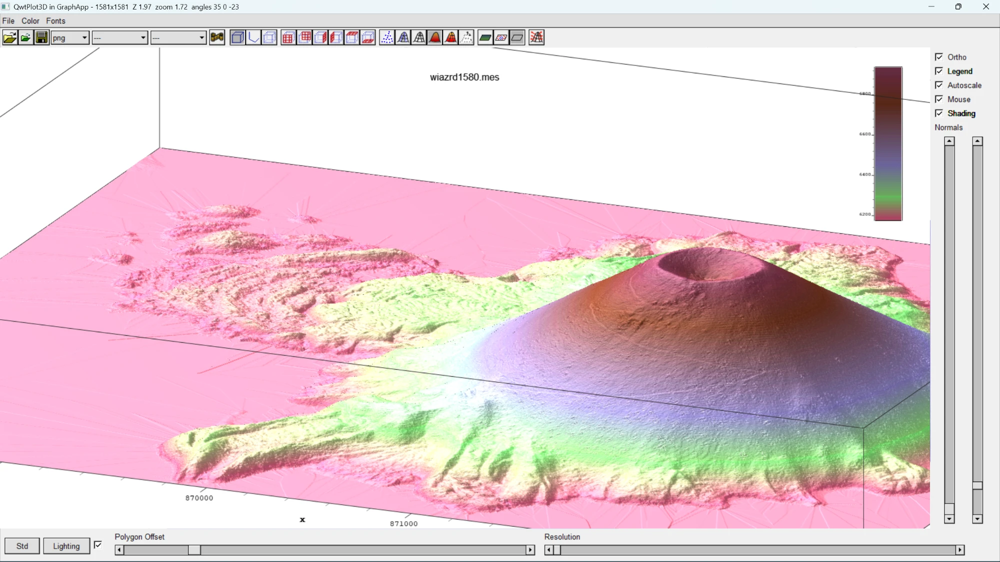

# QwtPlot3D for GraphApp

An example of moving a Qt application to GraphApp: QwtPlot3D 0.2.6, a 3D surface plotting library,
with Qt removed, and its demo rebuilt on GraphApp. This is an altered version of Michael Bieber's
library, not the original. See `COPYING` (zlib license) and `3rdparty/gl2ps/COPYING.*`. It runs on
Windows and on Linux with X11.



The Qt build this came from was a 60 MB folder of programs, Qt DLLs and plugins. This demo is one
small executable that links only `OPENGL32`, `GLU32` and Windows system DLLs, and it fits on a single
1.44 MB floppy with room to spare. The Qt folder would take about 40. The Linux build is a single
926 KB file that needs only the system's OpenGL, GLU and X11 libraries, so it fits on a floppy too.

## What the port took

About 9,000 lines of library code, most of them raw OpenGL that never touched Qt. The work was in a
few places:

- `QGLWidget` became a small child window with an OpenGL context.
- `QString` became `std::string`, and `QFont` a small value type.
- Label text, drawn by `QPainter` before, now comes from a GraphApp bitmap.
- Signals became `std::function` members.

Moving it to X then took one file for the OpenGL window, `src/qwt3d_glwidget_x11.cpp`, and a small
bridge to GraphApp's insides. The library and the 1,500-line demo compile unchanged, and so does
GraphApp: because the port keeps everything that depends on the system behind `GLWidget`, the plot
and its window don't know which one they're on.

## Build

**Windows:** run `build.bat` from an x64 Native Tools Command Prompt. It uses this repository's
GraphApp headers and `Windows Binaries\graphapp.lib`, and produces `lib\qwtplot3d.lib` and
`demo\surface_demo.exe`.

**Linux:** run `make` in the `src` folder for `libapp.a`, then `sh build.sh` here. It needs the
`libgl-dev`, `libglu1-mesa-dev` and `libx11-dev` packages and produces `lib/libqwtplot3d.a` and
`demo/surface_demo`. Set `GRAPHAPP_LIB` to link another `libapp.a`.

GraphApp itself needs no changes.

## Use

```cpp
#include <qwt3d_surfaceplot.h>   // before graphapp.h: its macros would break these headers
#include <qwt3d_function.h>

extern "C" {
#include "graphapp.h"
}

Window* win = new_window(app, rect(60, 60, 900, 680), "Plot", STANDARD_WINDOW);
Qwt3D::SurfacePlot* plot = new Qwt3D::SurfacePlot(win, 0, 0, 900, 680);
// load data as with the Qt version, then set axis labels: new data resets them
show_window(win);
plot->show();
main_loop(app);
```

Link `qwtplot3d.lib`, `graphapp.lib`, `opengl32.lib` and `glu32.lib`, or on Linux `libqwtplot3d.a`,
`libapp.a` and `-lGL -lGLU -lX11 -lm`. Resize the plot with `plot->setGeometry()` from your
`on_window_resize` handler.

Set an axis label on all four parallel axes (`X1`..`X4` and so on): the box shows whichever one
faces the viewer.

## Prebuilt binary

`bin\surface_demo.exe` is a 64-bit Windows build. It needs no other files: the C runtime is linked in
and the icons are embedded.

`bin/surface_demo` is a 64-bit Linux build, made on Ubuntu 24.04. It needs the system's OpenGL, GLU
and X11 libraries. For the file dialogs, GraphApp uses zenity, kdialog, qarma or matedialog if one is
installed, and its own dialog if not.

## LIDAR grids

`bin\surface_demo.exe grid.mes`, or File > Open. Color > Data color takes `.map` files of `r g b`
lines from 0 to 255, and `colormaps\` has 141 of them. No grids are included. **Shift+wheel exaggerates Z** and the plain wheel zooms,
as in mesh2: each notch adds 0.0513 to the Z scale. Grids open at 1 point in 3, like mesh2; the
Resolution menu goes down to every point. The title bar shows what mesh2's status bar did.

The window follows mesh2. The toolbar has open, FEM open, save with its format list, the function
and surface lists, animation, coordinate style, the six side grids, six plot styles, three floor
styles and normals, with mesh2's icons (embedded in `demo/icons.h`). The menus have the color and
font choices. On the right are Ortho, Legend, Autoscale, Mouse and Shading, with sliders for the
quality and length of the normals; below are Std, the lighting check box, the Lighting dialog, and
sliders for Polygon Offset and Resolution. In the dialog, turn the sphere with the mouse to move the
light; its sliders set Distance, Emission, Ambient and Diffuse, Specular and Shininess.
Lighting turns relief into shading, which often shows more than color alone.

Unlike mesh2, a grid opens in the Filled style, because the mesh lines of a dense grid come out
solid black, and with box axes, where mesh2 starts with none. File > Save As is an addition.

Tested on 1409x1409 and 1581x1581 LIDAR grids (2.5 million points): about 1.3 s to open, and at
every resolution redraws keep up with the 240 Hz display. A failed read leaves the plot as it was.

## What changed from the Qt version

| Qt | Here |
|---|---|
| `QGLWidget` | `Qwt3D::GLWidget`, a child window with an OpenGL context |
| `SurfacePlot(QWidget*)` | `SurfacePlot(Window*, x, y, width, height)` |
| `QString`, `QStringList` | `std::string` (UTF-8), `std::vector<std::string>` |
| `QFont` | `Qwt3D::Font` |
| Signals | `std::function` members: `onRotationChanged`, `onShiftChanged`, `onViewportShiftChanged`, `onScaleChanged`, `onZoomChanged`, `onProjectionChanged`, `onResolutionChanged` |
| `Qt::LeftButton`, `Qt::ShiftModifier` | `Qwt3D::LeftButton`, `Qwt3D::ShiftModifier` |
| Image formats from Qt | PNG and GIF, from GraphApp |
| `renderPixmap` | Removed; `grabFrameBuffer` returns RGBA |
| `PixmapWriter::setQuality` | Kept, has no effect |

Everything else, including mouse and keyboard defaults and EPS, PS and PDF output, is as it was.
Labels are now antialiased, where the original had a 1-bit mask.

## How it sits on GraphApp

- `src/qwt3d_glwidget_win32.cpp` is the only file that sees `windows.h` and WGL.
- `src/qwt3d_graphapp_host.cpp` is the only file that sees `graphapp.h`.

The plot is a child window because GraphApp fills its window with GDI before every redraw and does
not report Alt with the mouse or Alt+arrow keys. Three GraphApp behaviors shape that file:

- **Menus:** GraphApp draws them on the window with GDI, which cannot draw over an OpenGL child. When
  the parent gets a left press or Alt key, the plot's current frame is copied to the parent and the
  child hides until GraphApp returns. No parent redraw may happen in between, because a `WM_PAINT`
  ends GraphApp's menu loop.
- **Subclassing:** `app_winproc` ignores a window unless `GWLP_WNDPROC` is itself, so the parent's
  original procedure is put back around every call.
- **Text beyond Latin-1:** GraphApp's native fonts keep only the low byte of a character (pi comes
  out as A with a grave accent), so such strings go through GDI directly. Everything else uses
  GraphApp fonts.

The parent's HWND is read as the first field of GraphApp's private `WindowExtra`.

### On X11

- `src/qwt3d_glwidget_x11.cpp` is the only file that sees Xlib and GLX.
- `src/qwt3d_x11_bridge.c` is the only file that sees GraphApp's private headers.

GraphApp reads the X events itself and drops those of windows it doesn't know. So an ordinary
GraphApp window is created and its X window swapped for a child with an OpenGL visual, on GraphApp's
own connection, and its event loop then serves the plot like any other window. The child is never
shown with `show_window`, so the main loop doesn't wait for it. Four things differ from Windows:

- **Keys:** the child doesn't ask for key events, so X passes them up to the main window, where the
  menu shortcuts and key handlers are. The arrow keys arrive through the main window's key action.
- **Menus:** the same answer as on Windows. The menu bar's press handler is wrapped, the frame is
  copied to the parent and the child unmapped. The parent's expose events are dropped from the queue,
  because one would end GraphApp's menu loop.
- **Mouse state:** GraphApp reports Shift+left as the right button, so X is asked what is really held.
- **Text beyond Latin-1:** drawn with X's own iso10646 fonts, so no extra library is needed.

To port this to another system, start from those two files: everything else stays as it is.

## Color maps

The `.map` files in `colormaps\` came with the Qt version's binaries. Their license is unknown, and
they are not covered by the licenses above.

## Limits

- Windows and Linux with X11. macOS needs a Cocoa version of the OpenGL child window.
- File dialogs and messages come from GraphApp. Its file dialogs take no filter, so all files are listed and the title says what to pick. It has no color or font dialog: Windows uses its own, and on Linux you type the color (`255 128 0`) or font (`Helvetica 12 bold`).
- On Linux the labels use GraphApp's bitmap X fonts, so they look plainer than on Windows, and text beyond Latin-1 comes out as wrong letters if the X server has no iso10646 fonts. WSLg has none, and that path has not yet been seen working.
- JPEG is not offered: `app_save_jpeg` in GraphApp is a stub that always fails.
- Needs a legacy OpenGL compatibility context. Tested on one GPU only. On Linux, tested only under WSLg, which runs X through Xwayland.
- The demo is not DPI aware, so at 150% scaling Windows enlarges it and text looks soft.
- Differences from mesh2: no color map preview, the save list has PNG, GIF, EPS, PS and PDF only,
  EPS and PDF text is part of the file where mesh2 wrote a separate TeX file, and the title bar
  stands in for its status bar.
