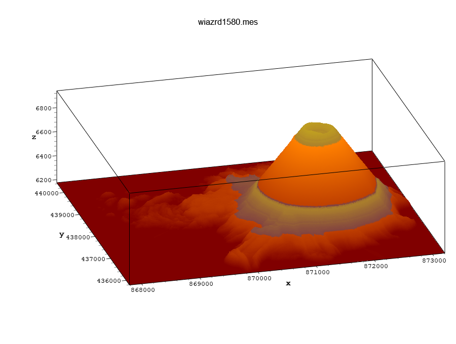

# QwtPlot3D for GraphApp

An example of moving a Qt application to GraphApp: QwtPlot3D 0.2.6, a 3D surface plotting library,
with Qt removed, and its demo rebuilt on GraphApp. This is an altered version of Michael Bieber's
library, not the original. See `COPYING` (zlib license), `3rdparty/gl2ps/COPYING.*` and the license
at the top of `3rdparty/tinyfd/tinyfiledialogs.h`.



The Qt build this came from was a 60 MB folder of programs, Qt DLLs and plugins. This demo is one
small executable that links only `OPENGL32`, `GLU32` and Windows system DLLs.

## What the port took

About 9,000 lines of library code, most of them raw OpenGL that never touched Qt. The work was in a
few places:

- `QGLWidget` became a small child window with an OpenGL context.
- `QString` became `std::string`, and `QFont` a small value type.
- Label text, drawn by `QPainter` before, now comes from a GraphApp bitmap.
- Signals became `std::function` members.

## Build

Run `build.bat` from an x64 Native Tools Command Prompt. It uses this repository's GraphApp headers
and `Windows Binaries\graphapp.lib`, and produces `lib\qwtplot3d.lib` and `demo\surface_demo.exe`.
GraphApp itself needs no changes.

## Use

```cpp
#include <qwt3d_surfaceplot.h>   // before graphapp.h: its macros would break these headers
#include <qwt3d_function.h>

extern "C" {
#include "graphapp.h"
}

Window* win = new_window(app, rect(60, 60, 900, 680), "Plot", STANDARD_WINDOW);
Qwt3D::SurfacePlot* plot = new Qwt3D::SurfacePlot(win, 0, 0, 900, 680);
// load data as with the Qt version, then set axis labels: new data resets them
show_window(win);
plot->show();
main_loop(app);
```

Link `qwtplot3d.lib`, `graphapp.lib`, `opengl32.lib` and `glu32.lib`. Resize the plot with
`plot->setGeometry()` from your `on_window_resize` handler.

Set an axis label on all four parallel axes (`X1`..`X4` and so on): the box shows whichever one
faces the viewer.

## LIDAR grids

`demo\surface_demo.exe grid.mes`, or File > Open. Color > Open Color Map takes `.map` files of
`r g b` lines from 0 to 255. No grids or maps are included. **Shift+wheel exaggerates Z** and the plain wheel zooms,
as in mesh2: each notch adds 0.0513 to the Z scale. Grids open at 1 point in 3, like mesh2; the
Resolution menu goes down to every point. The title bar shows what mesh2's status bar did.

The controls follow mesh2: Ortho, Legend, Autoscale, Mouse, Shading and Normals on the right, with
sliders for the quality and length of the normals; below, Std, the lighting check box, the Lighting
dialog, and sliders for Polygon Offset and Resolution. In the dialog, turn the sphere with the mouse
to move the light; its sliders set Distance, Emission, Ambient and Diffuse, Specular and Shininess.
Lighting turns relief into shading, which often shows more than color alone.

Unlike mesh2, a grid opens in the Filled style, because the mesh lines of a dense grid come out
solid black, and with box axes.

Tested on 1409x1409 and 1581x1581 LIDAR grids (2.5 million points): about 1.3 s to open, and at
every resolution redraws keep up with the 240 Hz display. A failed read leaves the plot as it was.

## What changed from the Qt version

| Qt | Here |
|---|---|
| `QGLWidget` | `Qwt3D::GLWidget`, a child window with an OpenGL context |
| `SurfacePlot(QWidget*)` | `SurfacePlot(Window*, x, y, width, height)` |
| `QString`, `QStringList` | `std::string` (UTF-8), `std::vector<std::string>` |
| `QFont` | `Qwt3D::Font` |
| Signals | `std::function` members: `onRotationChanged`, `onShiftChanged`, `onViewportShiftChanged`, `onScaleChanged`, `onZoomChanged`, `onProjectionChanged`, `onResolutionChanged` |
| `Qt::LeftButton`, `Qt::ShiftModifier` | `Qwt3D::LeftButton`, `Qwt3D::ShiftModifier` |
| Image formats from Qt | PNG and GIF, from GraphApp |
| `renderPixmap` | Removed; `grabFrameBuffer` returns RGBA |
| `PixmapWriter::setQuality` | Kept, has no effect |

Everything else, including mouse and keyboard defaults and EPS, PS and PDF output, is as it was.
Labels are now antialiased, where the original had a 1-bit mask.

## How it sits on GraphApp

- `src/qwt3d_glwidget_win32.cpp` is the only file that sees `windows.h` and WGL.
- `src/qwt3d_graphapp_host.cpp` is the only file that sees `graphapp.h`.

The plot is a child window because GraphApp fills its window with GDI before every redraw and does
not report Alt with the mouse or Alt+arrow keys. Three GraphApp behaviors shape that file:

- **Menus:** GraphApp draws them on the window with GDI, which cannot draw over an OpenGL child. When
  the parent gets a left press or Alt key, the plot's current frame is copied to the parent and the
  child hides until GraphApp returns. No parent redraw may happen in between, because a `WM_PAINT`
  ends GraphApp's menu loop.
- **Subclassing:** `app_winproc` ignores a window unless `GWLP_WNDPROC` is itself, so the parent's
  original procedure is put back around every call.
- **Text beyond Latin-1:** GraphApp's native fonts keep only the low byte of a character (pi comes
  out as A with a grave accent), so such strings go through GDI directly. Everything else uses
  GraphApp fonts.

The parent's HWND is read as the first field of GraphApp's private `WindowExtra`.

## Limits

- Windows only. Linux needs a backend with a child X window and GLX; macOS needs a Cocoa one.
- File dialogs and messages come from tinyfiledialogs (`3rdparty/tinyfd`): GraphApp's are poor. It rejects text with quotes, so `dialogText` replaces them.
- JPEG is not offered: `app_save_jpeg` in GraphApp is a stub that always fails.
- Needs a legacy OpenGL compatibility context. Tested on one GPU only.
- The demo is not DPI aware, so at 150% scaling Windows enlarges it and text looks soft.
- The demo covers mesh2's main use, not all of it. Not ported: frame or no coordinate system, side
  grids, floor styles, the color pickers for axes, background, mesh and text, the Fonts menu,
  animation, FEM (`.nod`/`.cel`) files, most of its built-in functions and surfaces, and the color
  map preview.
